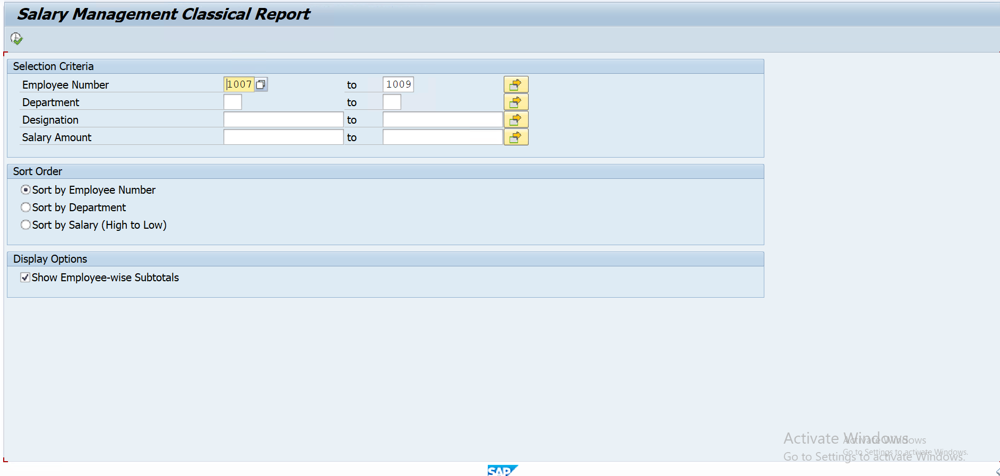
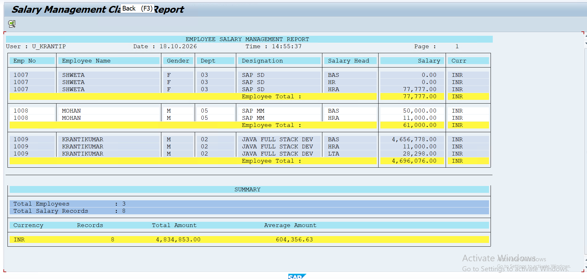

# Employee Salary Management - Classical Report (SAP ABAP)

A classical list report in SAP ABAP that displays employee salary data by joining the employee master and salary master tables. The output has a page header, footer, colored headings, grid lines, subtotals, a summary section and double-click drill-down.

**Program name:** `Y182_EMP_SALARY_REPORT`

---

## Table of Contents

- [Screenshots](#screenshots)
- [Database Tables](#database-tables)
- [Features](#features)
- [Selection Screen](#selection-screen)
- [Output Layout](#output-layout)
- [Events Used](#events-used)
- [Installation](#installation)
- [How to Run](#how-to-run)
- [Requirements](#requirements)
- [Future Enhancements](#future-enhancements)
- [Author](#author)
- [License](#license)

---

## Screenshots

### 1. User Input Window (Selection Screen)

### 2. Output Window (Report Output)

---

## Database Tables

| Table | Description |
|-------|-------------|
| `Y182M_EMPMST` | Employee master data |
| `Y182M_SALMST` | Employee salary master data |

**Join condition:** `Y182M_EMPMST-EMPNO = Y182M_SALMST-EMPNO`

| Field | Source Table | Meaning |
|-------|--------------|---------|
| `EMPNO` | `Y182M_EMPMST` | Employee number |
| `EMPNM` | `Y182M_EMPMST` | Employee name |
| `GENDER` | `Y182M_EMPMST` | Gender |
| `DEPTCD` | `Y182M_EMPMST` | Department code |
| `DESIGNATION` | `Y182M_EMPMST` | Designation |
| `PHONE_NO` | `Y182M_EMPMST` | Phone number |
| `SALHD` | `Y182M_SALMST` | Salary head |
| `SALARY` | `Y182M_SALMST` | Salary amount |
| `WAERS` | `Y182M_SALMST` | Currency key |

---

## Features

- Page header with report title, user, date, time and page number
- Page footer with page number
- Colored headings and a grid with vertical and horizontal lines
- Alternating row shading for each employee
- Sort options: by employee number, department, or salary (high to low)
- Employee-wise subtotals (optional)
- Summary section with total employees, total records, and total and average salary per currency
- Double-click on an employee row to open a pop-up with employee details and all salary heads
- Friendly message when no records are found

---

## Selection Screen

| Field | Description |
|-------|-------------|
| Employee Number | Range of `EMPNO` |
| Department | Range of `DEPTCD` |
| Designation | Range of `DESIGNATION` |
| Salary Amount | Range of `SALARY` |
| Sort Order | Employee number, department, or salary (high to low) |
| Show Employee-wise Subtotals | Turns subtotals on or off |

---

## Output Layout

| Column | Field |
|--------|-------|
| Emp No | `EMPNO` |
| Employee Name | `EMPNM` |
| Gender | `GENDER` |
| Dept | `DEPTCD` |
| Designation | `DESIGNATION` |
| Salary Head | `SALHD` |
| Salary | `SALARY` |
| Curr | `WAERS` |

After the data rows, the report prints a **Summary** block with total employees, total records, and total and average amount per currency.

---

## Events Used

| Event | Purpose |
|-------|---------|
| `INITIALIZATION` | Set selection screen texts |
| `START-OF-SELECTION` | Read data with a join and sort it |
| `END-OF-SELECTION` | Print the list, subtotals and summary |
| `TOP-OF-PAGE` | Print the page header and column headings |
| `END-OF-PAGE` | Print the page footer |
| `AT LINE-SELECTION` | Show employee details on double-click (`HIDE`) |

---

## Installation

1. Make sure the tables `Y182M_EMPMST` and `Y182M_SALMST` exist in your SAP system with the fields listed above.
2. Open transaction **SE38** and create an executable program named `Y182_EMP_SALARY_REPORT`.
3. Copy the code from `y182_emp_salary_report.abap` into the program.
4. Save and activate (**Ctrl + F3**).

---

## How to Run

1. Open **SE38**, enter `Y182_EMP_SALARY_REPORT` and press **F8**.
2. Fill the selection screen, or leave it blank to see all records.
3. Choose the sort order and whether to show subtotals.
4. Press **F8** (Execute).
5. Double-click an employee row to see the employee details pop-up.

---

## Requirements

- SAP system with **ABAP 7.40 SP08 or higher** (uses inline declarations and `@` host variables)
- Authorization to create and run programs (SE38)
- The tables `Y182M_EMPMST` and `Y182M_SALMST` with data

---

## Future Enhancements

- Add authority checks for department-wise access
- Add a department-wise header with a subtotal per department
- Add currency conversion to compare salaries across currencies
- Convert the output to ALV for filtering and Excel export

---

## Author

**Your Name**
SAP ABAP Developer
